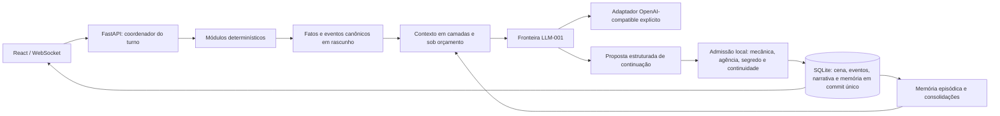

# Guia técnico — Agente Storyteller

Detalhes de arquitetura, configuração e ensaios do repositório de desenvolvimento.
A apresentação pública e os limites atuais estão no [README](README.md).
Exemplos de provedores abaixo são registros técnicos datados, não modelos admitidos,
recomendações atuais de catálogo ou autorização de inferência. Antes de qualquer
execução real, confira o checkpoint e o protocolo específico. Para avaliações Luna,
use o mecanismo protegido descrito em [sessão temporária](plan/process-luna-credential-lease-1.md).

## Estado do desenvolvimento

O MVP está em desenvolvimento e nenhum narrador/default foi admitido. Protocolos
e lotes de avaliação não constituem aprovação de produto nem autorização para
executar chamadas pagas. Consulte `PROMPT_RETOMADA_2026-09-06.md` para o checkpoint
vigente e `docs/repository-promotion.md` para a promoção GitHub autorizada.
As correções e os limites da auditoria estão em `docs/security-audit/README.md`.

## Pausa e retomada do Narrador

Quando H6 falha por indisponibilidade transitória confirmada como retomável, o jogo preserva no servidor a ação, a resolução determinística, o contexto selecionado e o alvo exato. A tentativa original termina sem alterar o estado canônico. A interface mostra **Narração pausada** e permite:

- **Retomar narração** cria uma operação nova e tenta somente H6 uma vez. Regras, dados, H0, H1 e H4 não são executados novamente.
- **Descartar ação** abandona logicamente a proposta; os efeitos preservados não são aplicados.

O editor continua disponível como rascunho local, mas envio, atalhos e rolagens ficam bloqueados enquanto houver uma pausa ativa. Refresh, reconexão e restart reidratam o cartão. Não existe verificação sintética de disponibilidade, retry automático, troca automática de modelo ou exclusão física automática da cápsula no piloto local.

O cliente recebe somente IDs opacos, resumo da ação e da resolução, categoria normalizada, mensagem segura e timing comprovado quando existir. Chaves, headers, `scope_key`, prompt, contexto confidencial e saída provisória não fazem parte do contrato público.

---

## Visão geral

O Agente Storyteller combina uma interface React com um backend FastAPI. Regras,
cálculos, transições e estado canônico permanecem sob controle dos módulos locais;
o LLM recebe contexto estruturado e propõe a continuação da ficção. A aplicação
valida essa proposta antes de admitir novos fatos de cena: o modelo não pode
substituir resultados mecânicos nem confirmar sozinho o que passa a ser canônico.

A premissa de experiência é condução por improviso: em cada entrada ficcional
significativa, o mundo reage, revela, complica ou avança uma pendência e devolve ao
jogador uma oportunidade concreta de agir. Eventos passados são imutáveis; a cena
e a projeção atual do mundo evoluem por novos eventos validados.

`local-first` descreve o controle do núcleo e dos dados. A inferência pode apontar
para qualquer alvo explicitamente configurado que implemente o protocolo
OpenAI-compatible e as capabilities exigidas. O produto não escolhe provedor,
modelo, endpoint ou fallback silenciosamente.

Este documento descreve o núcleo de desenvolvimento; não é uma distribuição
pronta para jogadores nem uma declaração de release.

## Arquitetura do turno



- **Autoridade determinística:** regras, dados rolados, invariantes e transições
  são calculados localmente e registrados como fatos estruturados.
- **Autoridade ficcional limitada:** H6 pode propor observações, pistas, reações
  externas, complicações, transições e ganchos. A política local confere resultado
  mecânico, agência, visibilidade e continuidade antes de criar IDs e canonizar.
- **Fronteira LLM agnóstica:** texto, geração estruturada e streaming usam um
  contrato interno com capabilities, deadline, cancelamento, erros normalizados,
  proveniência e uso/custo observáveis. SDK e detalhes HTTP ficam no adaptador.
- **Turno atômico:** estado, cena, narrativa concluída, eventos, relações e memória
  são promovidos juntos. A proposta estruturada é mantida interna e a prosa só é
  publicada depois da validação; falhas não deixam mutação parcial nem consomem o
  turno com um beat técnico.
- **Memória em camadas:** contexto quente, episódios, estado semântico e
  arcos/pendências são separados; recuperação filtra visibilidade e aplica orçamento.
- **Persistência segura:** SQLite usa transações e migração lazy, idempotente e
  não destrutiva dos JSON legados. Os arquivos-fonte não são reescritos.

O MVP executa o backend como um único processo/worker. O SQLite serializa escritas
entre conexões, mas os locks de sessão que coordenam leituras e atualizações vivem
no processo da aplicação; não configure múltiplos workers nesta etapa.
No startup, tentativas `pending` anteriores ao início do processo são encerradas
como canceladas sem promover estado. Schemas legados incompatíveis com as
invariantes suportadas são recusados antes de qualquer mutação automática.

## Direção B: ponte interna de fontes atribuídas

A entrada interna `execute_source_turn` exige uma campanha criada por
`SQLitePersistence.create_narrative_source_campaign`, com cena conhecida e elenco
fixo. `read_source_context_snapshot` confere origem, revisão e toda a história
elegível antes de recuperar as duas últimas fontes integrais. Um recibo registra
os IDs selecionados e omitidos; `n` permanece atribuído e `q` separado.

Essa entrada recusa campanhas existentes e dependências de memória/cena v1.
Ela é exercitada com dados sintéticos e não altera a seleção do jogo atual.
Contrato, testes e limites no [relatório da integração interna B](evals/narrator/reports/narrative-source-readers-2026-09-10.md).

O preparador interno `prepare_source_turn_draft` transforma uma declaração
explícita do servidor ou um teste ordinário já resolvido em rascunho B, preservando
o recibo e sem nova rolagem. Ele não classifica texto livre nem aplica efeitos;
[escopo e integração local](evals/narrator/reports/narrative-source-preparation-2026-09-10.md).

`prepare_retained_source_turn` conserva essa preparação em uma cápsula no SQLite;
`execute_retained_source_turn` a recupera por sessão/operação. Reinício e replay
usam o recibo retido; tentativas pendentes ou terminais não autorizam reenvio.
A retenção é uma operação de controle, sem novo turno ou avanço de estado.
[Contrato, provas e limites do coordenador](evals/narrator/reports/narrative-source-coordinator-2026-09-10.md).

`SQLitePersistence.read_source_operation_status` consulta o estado de uma operação
retida e sua causa segura de falha, incluindo após reinício. A resposta separa
a revisão-base da atual; uma preparação antiga não promete prontidão. A leitura
usa banco existente em modo somente leitura e não executa novamente a operação.
[Contrato e verificação da consulta](evals/narrator/reports/narrative-source-operation-status-2026-09-11.md).

`SourcePlayerActionRequest` define a futura entrada B com somente `operation_id`
e `player_input`. A guarda interna revalida a origem contra a sessão do servidor;
não classifica a ação ou produz recibo. O limite é de 500 caracteres de texto e
240 de identidade B, com preservação literal das entradas aceitas.
[Contrato e 161 verificações focadas](evals/narrator/reports/narrative-source-entry-2026-09-11.md).
O produtor interno `prepare_source_player_action` já reserva a operação antes
de interpretar/rolar e retém cápsula/conclusão atomicamente. O perfil local aceita
espera, fala dirigida e investigação ordinária; o coordenador retido recebe o
recibo sem nova rolagem. [Contrato, provas e limites](evals/narrator/reports/narrative-source-input-producer-2026-09-11.md).
`create_source_trial_setup` cria a preparação autorada de uma cena B nova; local,
elenco e objetivo ficam em manifesto separado de qualquer fonte do modelo.
`read_source_setup_manifest` reapresenta esse briefing após reinício sem criar
turno. A composição interna até H6 foi verificada com respostas sintéticas.
[Setup e 488 verificações distintas](evals/narrator/reports/narrative-source-setup-2026-09-11.md).
O [transporte optativo](plan/feature-narrative-source-transport-1.md) possui contrato
público estrito, seletor server-side, factory/handler separados e página própria.
Em 21/09/2026, o recorte foi aceito para um único operador local, somente em
`127.0.0.1`. O encerramento WebSocket e o painel estreito foram corrigidos e
reverificados. O jogo padrão continua no fluxo v1 atual.
A [observação do produtor com diálogo e espera](evals/narrator/reports/source-player-observation-83921947-2026-09-11.md)
foi encerrada: dois turnos confirmados e replay verificado. Continuidade e agência
foram preservadas, mas o avanço narrativo foi parcial. A aceitação posterior cobre
somente o opt-in local; não escolhe narrador definitivo nem aprova CAP-001.

## Interface

O frontend mantém os temas góticos claro e escuro e trata separadamente narrativa,
terminal do turno e snapshot canônico. Em falha, timeout ou cancelamento, nenhuma
proposta parcial é promovida ao histórico concluído.

## Uso teste isolado do jogo atual com Groq

Com a interface compilada e as dependências existentes, o launcher abaixo abre uma
sessão inventada em SQLite temporário. A chave é solicitada no terminal protegido,
sem ler `.env`. Ele usa explicitamente Groq/Qwen, realiza a verificação inicial do
narrador e mantém a janela aberta até você encerrar o servidor com Enter.

```powershell
pwsh -NoProfile -File scripts/run_storyteller_manual_test.ps1 -TestId ([guid]::NewGuid())
```

O endereço da sessão aparece no terminal. A porta8000 precisa estar livre; o script
não reutiliza servidores alheios. Sem opção de retomada, recusa bancos anteriores. Esse comando abre o fluxo
atual do jogo. A ponte experimental de fontes da direção B não é ativada.
Para verificar somente a preparação, sem chave ou modelo, acrescente `-PreflightOnly`.

Para retomar explicitamente um teste isolado já existente, use um identificador
novo para os logs e indique o identificador original do banco:

```powershell
pwsh -NoProfile -File scripts/run_storyteller_manual_test.ps1 -TestId ([guid]::NewGuid()) -ResumeFromTestId <GUID-do-teste-original>
```

A retomada preserva a URL/sessão e o SQLite original, verifica a identidade em modo
somente leitura e solicita a chave novamente. Não recupera credenciais anteriores.
O servidor anterior deve estar encerrado. IDs de retomadas encerradas não podem
ser reutilizados; preparação offline pode transitar para uma abertura. O launcher
configura768 tokens estimados de contexto narrativo, mantendo fatos obrigatórios.
A abertura de uma sessão nova apresenta local e presenças; uma retomada não reinicia
a cena. A narrativa e a ficha rolam dentro da janela, com controles acessíveis.

### Entrada B optativa local

Esta entrada é separada do jogo v1 e atende somente o operador do desktop em
loopback. Ela não publica a API para outra máquina. Para validar a preparação sem
chave, banco, listener ou inferência:

```powershell
pwsh -NoProfile -File scripts/run_groq_source_local_trial.ps1 -PreflightOnly
```

Para abrir a sessão local, execute o mesmo comando sem `-PreflightOnly`. A chave é
solicitada como `SecureString` no PowerShell e existe somente no processo-filho:

```powershell
pwsh -NoProfile -File scripts/run_groq_source_local_trial.ps1
```

O lançador fixa backend em `127.0.0.1:8018`, frontend em `127.0.0.1:5178`, banco
sintético isolado, sessão escolhida pelo servidor e limites do ensaio. Enter encerra
somente os serviços pertencentes ao lançador. O `App` e o save v1 não são migrados.

## Quickstart de desenvolvimento

### Pré-requisitos

- Python 3.11 ou superior.
- Node.js `^20.19.0` ou `>=22.12.0`.
- Um único alvo LLM OpenAI-compatible, iniciado e escolhido explicitamente.

### 1. Backend e frontend

```bash
git clone --branch codex/planejamento-agente-storyteller-v5 https://github.com/CHCLopes/Agente-Storyteller-VampireTheMasqueradeV5.git
cd Agente-Storyteller-VampireTheMasqueradeV5

python -m venv .venv
# PowerShell: .\.venv\Scripts\Activate.ps1
# Linux/macOS: source .venv/bin/activate
pip install -r api/requirements.txt

cd client
npm ci
npm run build
cd ..
```

### 2. Configuração explícita

Crie o arquivo local de configuração a partir do template. Não versione o `.env`:

```powershell
Copy-Item .env.example .env
```

```bash
cp .env.example .env
```

Preencha os campos do alvo explícito:

```dotenv
LLM_TARGET_ID=identificador-local-da-configuracao
LLM_PROVIDER_LABEL=rotulo-informativo
LLM_MODEL=modelo-exato-esperado
LLM_BASE_URL=http://127.0.0.1:1234/v1
LLM_ADAPTER_KIND=openai-compatible
LLM_STRUCTURED_GENERATION=emulated
LLM_STREAMING=native
LLM_REASONING_EFFORT=none
```

`LLM_API_KEY` é opcional no adaptador genérico e obrigatório nos perfis remotos
OpenRouter, Gemini e NVIDIA NIM. `native`, `emulated`, `unsupported` e `unknown` são os
valores válidos de capability; o fluxo narrativo do MVP exige geração estruturada
disponível (`native` ou `emulated`). Streaming continua diagnosticado pelo contrato
LLM-001, mas H6 confirma a proposta estruturada completa antes de publicar a prosa
ao jogador. O modelo retornado pelo alvo deve coincidir com `LLM_MODEL`.

`LLM_REASONING_EFFORT` é opcional e só deve ser definido quando o adaptador
declarar suporte ao valor escolhido. No Gemini 3.7 Flash, apenas `low`, `medium`
e `high` são convertidos em `thinkingLevel`; `none` é recusado. Parâmetros de
sampling obsoletos, como temperatura, não são enviados. Quando omitido,
preserva-se o padrão do alvo.

`LLM_TIMEOUT_SECONDS` é o teto de cada invocação. H0, H1 e H4 preservam os
defaults de 15, 30 e 20 segundos por meio de `LLM_H0_TIMEOUT_SECONDS`,
`LLM_H1_TIMEOUT_SECONDS` e `LLM_H4_TIMEOUT_SECONDS`; aumentá-los nunca ultrapassa
o teto global. `LLM_SCENE_DIRECTOR_MAX_OUTPUT_TOKENS` limita a proposta JSON de
cena compacta (256 por padrão), e `LLM_SCENE_DIRECTOR_TEMPERATURE` controla a variação
criativa (0,65 por padrão). O campo legado `LLM_H6_MAX_OUTPUT_TOKENS` permanece
aceito por compatibilidade, mas não limita a nova proposta estruturada.

`CONTEXT_TOKEN_BUDGET` limita a recuperação e `NARRATOR_CONTEXT_TOKEN_BUDGET`
limita a projeção compacta efetivamente enviada ao H6. Fatos completos continuam
no rascunho e no commit transacional; a projeção omite JSON, faces de dados, IDs e
scores que não ajudam a narrativa.

O perfil padrão usa triagem H0 determinística, preserva literalmente a declaração
do jogador em H1 e mantém H4 no lore estático durante ações. Assim, somente H6
consome a LLM no turno ficcional normal. `LLM_H0_ENABLED`, `LLM_H1_ENABLED` e
`LLM_H4_ACTION_ENRICHMENT_ENABLED` continuam switches explícitos para avaliação,
mas vêm desligados e nunca transferem autoridade mecânica ao narrador.

O template não aprova o endpoint de exemplo acima nem qualquer provedor: ajuste os
valores ao alvo que você escolheu. Não há autodetecção ou fallback.

#### Perfil OpenRouter controlado

O adaptador OpenRouter é uma composição explícita do mesmo contrato LLM-001. Ele
aceita apenas as URLs oficiais, exige chave e provedor upstream fixo, desabilita
fallback de rota, requer suporte aos parâmetros enviados e aplica `data_collection:
deny` com ZDR. Cache e plugins de transformação são desabilitados; se a resposta
reportar transformação de pipeline ou omitir metadado de rota, ela é rejeitada de
modo conservador. A rota e o custo reportados entram na evidência. Identificadores dinâmicos como
`openrouter/free`, `openrouter/auto`, `:nitro`, `:floor`, `:exacto` e `:online` são
recusados. A variante estática `:free` continua permitida e precisa passar pelo
probe com o slug lógico solicitado preservado. Se o endpoint reportar um ID físico
ou versionado diferente, ele só é aceito quando os metadados comprovam rota direta,
provedor pinado e sucesso na primeira tentativa. Se o detalhamento opcional de
tentativas estiver presente, ele também precisa concordar com o endpoint selecionado;
esse ID físico fica registrado na proveniência.

Exemplo do candidato datado de 27/08/2026 — não é seleção automática nem garantia
de permanência no catálogo:

```dotenv
LLM_TARGET_ID=openrouter-glm-5-2-free-decarts
LLM_PROVIDER_LABEL=OpenRouter
LLM_MODEL=z-ai/glm-5.2:free
LLM_BASE_URL=https://openrouter.ai/api/v1
LLM_ADAPTER_KIND=openrouter
LLM_OPENROUTER_PROVIDER=decart
LLM_API_KEY=
LLM_STRUCTURED_GENERATION=native
LLM_STREAMING=native
```

Preencha `LLM_API_KEY` somente no arquivo local ignorado ou no ambiente do
processo. Reinicie completamente o backend depois de trocar o perfil: settings e
runtime são carregados uma vez e um processo antigo continua apontando para o alvo
anterior. Antes da primeira cena real, lembre que o contexto da campanha sai do
dispositivo e depende das políticas atuais do serviço e do provedor upstream.

O snapshot e os comparadores sintéticos estão em
`evals/narrator/openrouter_candidates_2026-08-27.json`. Catálogo, limites gratuitos
e políticas podem mudar; revalide-os em fontes oficiais antes de uma rodada nova.

#### Gemini direto: avaliação sintética e runtime protegido

O adaptador Gemini usa somente o endpoint oficial `generateContent`, sem SDK,
estado remoto, tools, retry ou fallback. O identificador `gemini-3.7-flash` fica
fixo e cada resposta deve reportar uma `modelVersion` compatível; aliases mutáveis
como `gemini-flash-latest`, versões preview e experimentais são recusados.

```dotenv
LLM_TARGET_ID=gemini-3-7-flash-campaign-approved
LLM_PROVIDER_LABEL=Google Gemini
LLM_MODEL=gemini-3.7-flash
LLM_BASE_URL=https://generativelanguage.googleapis.com/v1beta
LLM_ADAPTER_KIND=gemini
LLM_API_KEY=
LLM_STRUCTURED_GENERATION=native
LLM_STREAMING=native
LLM_REASONING_EFFORT=low
LLM_CAMPAIGN_DATA_ALLOWED=false
```

A chave é enviada somente no header `x-goog-api-key`; não use query string e não
registre a credencial. Crie uma Auth key atual no Google AI Studio e configure-a
apenas no ambiente local. O payload força `store: false`, mantém tools ausentes,
usa bloqueio `BLOCK_ONLY_HIGH` nas quatro categorias ajustáveis e valida novamente
todo JSON com Pydantic e invariantes do domínio.

Na modalidade gratuita, o Google pode usar prompts e respostas para melhorar
produtos e pode haver revisão humana. Por isso, `false` bloqueia este adaptador no
runtime principal: copiar o perfil não envia cenas, memórias ou segredos por
acidente. O teste gratuito usa exclusivamente o avaliador sintético abaixo, que
não abre saves, banco ou `.env`. Altere `LLM_CAMPAIGN_DATA_ALLOWED` para `true`
somente depois de confirmar uma política compatível para o projeto associado à
chave; esse opt-in não muda nem afrouxa as validações narrativas locais.

O manifesto auditável está em
`evals/narrator/gemini_candidates_2026-08-28.json`. As referências oficiais são o
[modelo estável](https://ai.google.dev/gemini-api/docs/models/gemini-3.7-flash),
o [contrato REST](https://ai.google.dev/api/generate-content), as
[chaves](https://ai.google.dev/gemini-api/docs/api-key) e os
[termos de dados](https://ai.google.dev/gemini-api/terms).

#### NVIDIA NIM: avaliação sintética e runtime protegido

O perfil NVIDIA usa a API OpenAI-compatible hospedada no endpoint oficial
`https://integrate.api.nvidia.com/v1`, com autenticação Bearer e sem SDK do
provedor. O modelo fica fixado em `nvidia/nemotron-3-ultra-550b-a55b`; o sistema
recusa troca silenciosa de modelo ou endpoint. A geração estruturada usa JSON
emulado, validado localmente por Pydantic, e o streaming permanece nativo.
Essa fixação protege o identificador lógico retornado pela API; o endpoint
hospedado não expõe digest do checkpoint e, portanto, não oferece a mesma
imutabilidade verificável de um NIM autogerenciado com imagem pinada.

```dotenv
LLM_TARGET_ID=nvidia-nemotron-3-ultra-550b-a55b-campaign-approved
LLM_PROVIDER_LABEL=NVIDIA NIM
LLM_MODEL=nvidia/nemotron-3-ultra-550b-a55b
LLM_BASE_URL=https://integrate.api.nvidia.com/v1
LLM_ADAPTER_KIND=nvidia
LLM_API_KEY=
LLM_STRUCTURED_GENERATION=emulated
LLM_STREAMING=native
LLM_CAMPAIGN_DATA_ALLOWED=false
```

No runtime, a credencial é lida exclusivamente de `LLM_API_KEY`, definida no
`.env` local ignorado ou no ambiente do processo. `NVIDIA_API_KEY` não é um alias
do runtime: ela existe apenas para a execução isolada do avaliador sintético. Essa
separação impede que uma chave de trial seja promovida por acidente ao jogo real.

O trial gratuito deve receber somente o corpus sintético, nunca cenas, memórias,
segredos ou outros dados da campanha. `LLM_CAMPAIGN_DATA_ALLOWED=false` mantém o
runtime bloqueado. Altere para `true` somente depois de contratar ou confirmar uma
política apropriada para os dados reais do projeto; o opt-in não reduz as
validações locais. O comando do screening e o manifesto auditável ficam em
`evals/narrator/README.md`.

As referências oficiais são o
[contrato da API LLM](https://docs.api.nvidia.com/nim/re/reference/llm-apis), o
[quickstart de autenticação](https://docs.api.nvidia.com/nim/re/docs/api-quickstart)
e os
[termos do trial](https://assets.ngc.nvidia.com/products/api-catalog/legal/NVIDIA%20API%20Trial%20Terms%20of%20Service.pdf).

### 3. Execução

Com o frontend compilado e o alvo já disponível:

```bash
python scripts/initialize_game.py
```

O inicializador sobe um único processo FastAPI na porta 8000, executa um probe
sintético sem dados da campanha e abre o navegador somente se a resposta indicar
`configured: true`, `ready: true` e `success: true`. Ele não instala nem inicia o
alvo LLM.

Também é possível iniciar manualmente:

```bash
uvicorn api.main:app --host 127.0.0.1 --port 8000 --reload
```

Para testar apenas a conexão, faça `POST` em
`http://127.0.0.1:8000/api/llm/test-connection`. O backend compartilha chamadas
concorrentes e mantém sucessos por 60 segundos para proteger a cota do provedor.
Falhas ficam em cache por 5 segundos, permitindo uma nova tentativa curta sem
repetir três chamadas a cada clique.

### 4. Testes

```bash
pytest -q

cd client
npm test -- --pool=threads --maxWorkers=1 --no-file-parallelism
npm run build
npm run lint
```

Os testes padrão usam adaptadores sintéticos e não exigem rede nem um LLM real.

A comparação viva é separada e opt-in. Ela não abre `.env`, saves ou banco da
campanha e recusa execução sem `--live`:

```powershell
$key = Read-Host "OpenRouter API key" -AsSecureString
$env:OPENROUTER_API_KEY = [System.Net.NetworkCredential]::new("", $key).Password
python scripts/evaluate_narrator_models.py --live --candidate glm-5.2-free-decarts-zdr
Remove-Item Env:OPENROUTER_API_KEY
Remove-Variable key
```

Uma repetição faz o screening de sete turnos, além dos probes de texto e stream.
Use `--repetitions 3` somente no finalista para obter as 21 respostas da aceitação
completa. Controles marcados como sintéticos exigem `--allow-synthetic-only`.
Relatórios são gravados em `eval-results/`, ignorado pelo Git; a chave nunca entra
no payload ou no relatório.

Para o screening Gemini gratuito, gere uma chave nova e informe-a somente ao
processo local:

```powershell
$key = Read-Host "Gemini Auth API key" -AsSecureString
$env:GEMINI_API_KEY = [System.Net.NetworkCredential]::new("", $key).Password
python scripts/evaluate_narrator_models.py --live --manifest evals/narrator/gemini_candidates_2026-08-28.json --candidate gemini-3.7-flash-free-synthetic --api-key-env GEMINI_API_KEY --allow-synthetic-only
Remove-Item Env:GEMINI_API_KEY
Remove-Variable key
```

Esse perfil não é elegível para dados reais de campanha.

## Topologia principal

```text
AgenteStoryteller/
├── api/
│   ├── llm/                       # contrato, runtime e adaptadores isolados
│   ├── context_service.py         # montagem e recuperação sob orçamento
│   ├── memory_service.py          # candidatos, episódios e consolidações
│   ├── persistence.py             # schema SQLite e migração dos JSON legados
│   ├── turn_execution_service.py  # unidade transacional do turno
│   ├── turn_models.py             # eventos, narrativa e memória tipados
│   ├── orchestrator_service.py    # regras, rascunho e narrador H6
│   └── main.py                    # composition root HTTP/WebSocket
├── client/src/                    # React, protocolo narrativo e HUD
├── data/                          # catálogos, fontes e saves locais
├── scripts/                       # inicialização e validação operacional
├── skills/                        # contratos de comportamento H0/H1/H4/H6
└── tests/                         # contrato, persistência, pipeline e regressão
```

## Manutenção

- Para integrar outro protocolo, implemente um adaptador da fronteira em
  `api/llm/adapters/` e faça a composição explícita em `api/llm/runtime.py`.
  O domínio não deve importar SDKs de provedor.
- Catálogos e parâmetros versionados podem permanecer em JSON. Cálculos,
  invariantes e transições pertencem aos módulos determinísticos testados.
- Eventos canônicos são imutáveis; resumos e consolidações são derivados,
  versionados e preservam referências às fontes.
- O store padrão fica em `data/saves/storyteller.sqlite3` e pode ser alterado por
  `STORYTELLER_DB_PATH`. Faça backup antes de mover dados reais.

---

<div align="center">
  Desenvolvido e mantido sob padrões de engenharia local-first. 🦇

  [](https://www.linkedin.com/in/carlos-lopes-b445aa201)
  [](https://github.com/CHCLopes)
</div>
