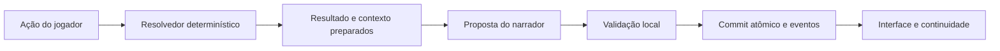

# Agente Storyteller

**Uma crônica de RPG que lembra suas escolhas — sem entregar as regras à IA.**


O Agente Storyteller investiga como combinar interpretação, liberdade narrativa
e consequências persistentes em uma experiência de RPG inspirada em
*Vampire: The Masquerade V5*. O jogador age; o sistema resolve a mecânica;
o narrador dá forma à cena dentro do que realmente aconteceu.

O projeto está saindo do desenvolvimento reservado para compartilhar sua
construção: o que já funciona, o que os testes revelaram e o que ainda precisa
amadurecer. **Ainda não é um jogo completo, um release do MVP ou uma demonstração
pública pronta para jogadores.**

## Por que este projeto existe

Uma boa sessão precisa de mais do que respostas convincentes de um modelo.
Precisa lembrar acontecimentos, respeitar o personagem do jogador e fazer a
história avançar sem inventar resultados mecânicos ou revelar segredos da campanha.

A proposta separa essas responsabilidades. Regras, rolagens e estado pertencem
ao sistema; a IA participa da narração, sem se tornar dona do cânone. O objetivo
é que o jogador participe da cena, em vez de apenas assistir a uma descrição.

## Onde estamos

**Checkpoint de 20 de outubro de 2026.** O núcleo técnico e uma microcampanha
experimental já permitem investigar continuidade, diálogo e desfechos. A
qualidade narrativa e a fronteira de validação continuam em avaliação.

| Frente | Estado atual |
| --- | --- |
| Interface local | React/TypeScript, comunicação com backend e histórico de turnos |
| Mecânica e persistência | Resolução determinística, RNG controlado e estado orientado a eventos |
| Continuidade | Contexto estruturado, limites de visibilidade e reconstrução de sessão |
| Pausa e retomada | Núcleo implementado, com testes de concorrência, persistência e retomada |
| Campanha híbrida | Microcampanha catalogada com Mara, escolhas e desfechos delimitados |
| Narrador | Experimentos comparativos e regressões; **nenhum narrador admitido** |
| MVP completo | **Em aberto**: aceitação integral e demais entregas do checklist ainda pendentes |

O perfil narrativo B e os ensaios com Luna são experimentais. Uma bateria aprovada
tecnicamente não equivale à aprovação do narrador nem à estabilidade geral do
produto. Foram encontrados tanto bloqueios indevidos quanto violações narrativas
aceitas pelo validador; correções locais não encerram essa questão arquitetural.

O próximo gate de produto é decidir como revisar a fronteira de validação antes
de continuar a admissão do narrador. A publicação deste código **não resolve nem
aprova essa decisão**. Veja o [checkpoint de validação](evals/narrator/reports/hybrid-campaign-luna-validation-checkpoint-2026-10-20.md).

## O que já está construído

- Interface jogável local, com área narrativa, HUD e preservação do rascunho do jogador.
- Backend modular em FastAPI, com contratos estruturados para ações e turnos.
- Resolvedor determinístico piloto e catálogos de contexto para o escopo da campanha.
- Persistência orientada a eventos e reconstrução do estado validado.
- Pausa e retomada de operações, com vínculos entre a execução original e a retomada.
- Microcampanha para observar ajuda, recusa contextual, resgate, perda e conclusão.
- Ferramentas de avaliação com hipóteses, limites, proveniência e registro de custo estimado.
- Testes de regressão para agência do jogador, segredo, progressão e integridade canônica.

Esses recursos têm cobertura delimitada por cenários. Não significam suporte
irrestrito a qualquer ação, NPC, aventura ou formulação de linguagem natural.

## Arquitetura do turno



A narração é uma proposta sujeita a validação, não uma autorização para alterar
regras ou controlar o jogador. O sistema mantém limites entre estado canônico,
conteúdo visível e informação reservada. A suficiência semântica dessa validação
é justamente uma das questões abertas do projeto.

**Local-first não significa necessariamente inferência local.** Persistência e
orquestração são locais; um provedor remoto, quando habilitado explicitamente,
recebe o contexto enviado naquela chamada. Ensaios de modelos usam fixtures
sintéticas, não campanhas pessoais.

## Tecnologias

| Camada | Tecnologias | Papel no projeto |
| --- | --- | --- |
| Interface | React 19, TypeScript 6, Vite 8, Tailwind CSS 4 | Interação, apresentação da cena e estado da interface |
| Backend | Python, FastAPI, Pydantic | Contratos, orquestração e validação |
| Estado | SQLite e eventos | Persistência e reconstrução de sessões |
| Verificação | pytest, Vitest, Testing Library | Regressões de backend e interface |
| Narração | Adaptadores de provedores e protocolos de avaliação | Experimentação controlada, sem modelo admitido como padrão do MVP |

## Explorar o repositório

O código mais recente deste checkpoint está na branch
`codex/planejamento-agente-storyteller-v5`. A branch de implementação e a `main`
podem ter estados diferentes; confira a branch antes de reproduzir um resultado.

Pré-requisitos: Git, Python compatível com as dependências do backend e Node.js
compatível com Vite 8. A instalação abaixo prepara o ambiente de desenvolvimento;
**não inicia serviços, não baixa pesos de modelos e não faz chamadas de IA**.

```powershell
git clone --branch codex/planejamento-agente-storyteller-v5 https://github.com/CHCLopes/Agente-Storyteller-VampireTheMasqueradeV5.git
cd Agente-Storyteller-VampireTheMasqueradeV5

python -m venv .venv
& .\.venv\Scripts\python.exe -m pip install -r api/requirements.txt

cd client
npm ci
npm run build
```

Para arquitetura detalhada, configuração e execução interativa, consulte o
[guia técnico](DEVELOPMENT.md). Os protocolos de ensaio têm alvos e limites
próprios: não execute lançadores de avaliações reais como parte da instalação.
Uma sessão com provedor exige configuração explícita e pode gerar custo.

### Verificação local sem credencial

Na raiz do repositório, um recorte útil para começar é:

```powershell
$env:STORYTELLER_DISABLE_DOTENV = '1'
& .\.venv\Scripts\python.exe -m pytest -q tests/test_campaign_source_profile.py tests/test_campaign_source_integration.py tests/test_campaign_goal_and_epilogue_regressions.py

cd client
npm test -- --pool=threads --maxWorkers=1 --no-file-parallelism
npm run build
```

Os testes Python isolam a persistência e bloqueiam rede externa pelo `conftest.py`.
Esse recorte não é a suíte inteira nem uma avaliação de qualidade narrativa por
um jogador. O repositório também conserva protocolos históricos congelados;
não os alteramos retroativamente para produzir resultados verdes.

## Qualidade e limites conhecidos

O desenvolvimento utiliza cenários reproduzíveis, contraprovas e regressões.
Os resultados devem ser lidos com seu escopo e snapshot, não como uma promessa
de ausência de falhas. Há falhas conhecidas na suíte histórica ampla e no lint;
elas estão discriminadas no [registro de publicação anterior](docs/repository-promotion.md).

As verificações deste checkpoint e suas exclusões estão no
[registro de sincronização](docs/repository-checkpoint-2026-10-20.md).
Os relatórios versionados documentam conclusões; resultados brutos locais de
execução ficam fora do Git. O [índice de avaliações](evals/narrator/README.md)
explica o processo de admissão.

Pontos de atenção atuais incluem naturalidade das falas, responsividade dos NPCs,
progressão e fidelidade entre resultado preparado e texto narrado. A campanha
experimental é um instrumento para testar isso, não uma campanha completa pronta.

## Segurança e privacidade

- Chaves, arquivos de ambiente, bancos locais, saves, logs e resultados brutos não fazem parte desta publicação.
- A integração com provedores é opt-in; não cole credenciais em issues, commits ou conversas.
- A sessão temporária de avaliação recebe a chave de forma protegida e a mantém no processo, com prazo de expiração; não é um cofre permanente nem revoga a chave no provedor.
- Tetos, autorizações e limites de chamadas são controles por ensaio, não autorização automática decorrente da instalação.
- As proteções e suas limitações estão documentadas nas [auditorias de segurança](docs/security-audit/README.md) e no [procedimento da supervisora](plan/process-luna-credential-lease-1.md).

## Próximas entregas do MVP

O [checklist aprovado](plan/checklist-planejamento-campanha-hibrida.md) organiza
o fechamento. O trabalho inclui resolver o gate da validação e a admissão do
narrador, concluir a campanha híbrida mínima, delimitar os catálogos necessários,
entregar a bandeja de dados e o conforto funcional da interface. Criação e ficha
do jogador ficam por último, antes da aceitação integral e da entrega.

Publicar o desenvolvimento não transforma esse backlog em release concluído.
Novas ideias não entram automaticamente no escopo do MVP.

## Como o projeto é construído

Carlos Henrique Lopes conduz intenção de produto, decisões de arquitetura,
prioridades e aceitação. O Codex apoia investigação, implementação, testes e
documentação dentro do escopo autorizado. Decisões humanas, evidências técnicas
e hipóteses experimentais são registradas separadamente.

O propósito de abrir essa construção é tornar o processo consultável: mostrar
os mecanismos, os problemas encontrados e os critérios usados para avançar,
sem apresentar um experimento como produto acabado.

## Documentação

- [Guia técnico e configuração](DEVELOPMENT.md)
- [Fonte de verdade para retomada](PROMPT_RETOMADA_2026-09-06.md)
- [Arquitetura da campanha híbrida](plan/architecture-hybrid-campaign-progression-1.md)
- [Plano de pausa e retomada](plan/feature-narrator-pause-resume-1.md)
- [Avaliações do narrador](evals/narrator/README.md)
- [Checkpoint desta publicação](docs/repository-checkpoint-2026-10-20.md)

## Autoria e direitos

Projeto de [Carlos Henrique Lopes](https://github.com/CHCLopes).
Contato profissional: [LinkedIn](https://www.linkedin.com/in/carlos-lopes-b445aa201/).

Este é um projeto independente, sem afiliação oficial com os titulares de
*Vampire: The Masquerade*. Marcas e material de terceiros pertencem aos seus
respectivos titulares. Não há arquivo `LICENSE` neste checkpoint; portanto,
este README não declara uma licença de uso ou redistribuição para o código.
