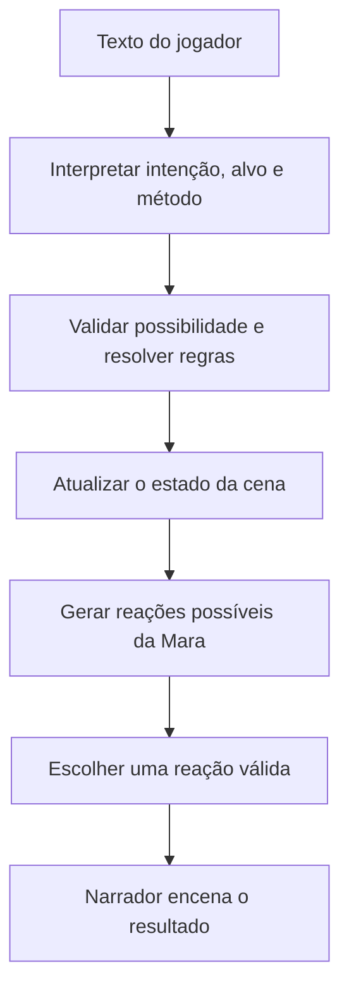

# Brainstorm para desenvolvimento em outro chat — 22/10/2026

## Instrução de transferência

Este documento contém o texto integral das duas mensagens substantivas do
brainstorm: a proposta do usuário e a análise do assistente. Não é a transcrição
de todo o histórico do projeto. Foram omitidos apenas mensagens operacionais,
saídas de ferramentas e metadados de citação interna de memória.

Quero desenvolver este brainstorm em um novo chat antes de decidir se ele deve
se tornar uma proposta de arquitetura do Agente Storyteller. Analise alternativas,
agência do jogador, checkpoints, representação de estado e viabilidade com modelos
gratuitos, leves ou locais. Preserve a distinção entre hipótese, recomendação e
resultado medido. Não trate a discussão como autorização de implementação,
contratação de API, troca de modelo ou alteração de decisões do projeto.

O chat original recebeu uma tarefa separada: concluir a opção E do ensaio A2,
testar as seis equivalências exatas, registrar resultados, fazer push e aguardar
minhas resoluções deste brainstorm. E não adota esta arquitetura nem amplia o
catálogo. O resultado técnico da etapa E deve ser consultado no relatório
`evals/narrator/reports/intent-paraphrase-integration-2026-10-22.md` quando concluído.

A pergunta aberta ao fim da discussão é: checkpoints admitem desfechos diferentes,
inclusive a perda do registro, ou exigem um resultado predeterminado? Ainda não
há resposta humana. Nenhuma recomendação abaixo está aprovada por este documento.

## Mensagem integral do usuário

Antes de responder a questão, precisamos fazer um brainstorm, antes de minha resposta. Ao ler a sua resposta, percebi que talvez seja possível diminuir a carga de decisão do modelo responsável pelo narrador em cima de comportamento, utilizando modelos de decisão como jev ou outro. Cheguei a essa conclusão quando vi o trecho de sua resposta que diz "analiso o registro => inspect" e "fico esperando => wait". Tem como analisar se teríamos impacto positivo caso fosse estruturada uma lista de palavras chave de comportamento que pudessem englobar a resposta do jogador, e balizar com outra lista que estivesse dentro das possibilidades de reação da personagem para só que o narrador só respondesse algo uma especie de improviso dentro do comportamento esperado limitado pelos determinísticos de personalidade, humor do npc , cenário, e relacionamentos presentes na cena? Exemplo específico possivel no caso Mara: a cena inicia detalhando a sala inundando e a posição dos dois e do registro dentro dela, eles na porta da sala pois acabaram de entrar e o registro no extremo oposto (localização e situação):, Mara aponta para o registro e informa sobre o perigo da infiltração em tom de urgência, se apresentando como guardiã do registro que foi roubado (ação plausível do npc baseada em situação atual+personalidade+relacionamento com o jogador), o narrador pergunta o que o jogador quer fazer. Tudo entre parênteses construído em formatos de palavras únicas de contexto dentro de um (JSON?) ou algo do tipo. O jev ou outro modelo decisório devolve as melhores certezas para alcançar o próximo grande Checkpoint do roteiro em direção ao melhor desfecho já escolhido, dentro de uma lista de probabilidades, o narrador as encena. A mesma coisa após a jogada do usuário

## Resposta integral do assistente

**Sim, essa estrutura tem potencial para reduzir a carga do narrador e facilitar o uso de modelos leves ou locais.** O ganho viria principalmente de entregar ao narrador uma cena cuja decisão já foi resolvida: quem age, o que pode fazer, qual consequência ocorreu e quais fatos podem aparecer na prosa.

Sua ideia aproxima o narrador de um ator que recebe direção de cena. Ele continua criando diálogo, atmosfera e ritmo, enquanto o sistema mantém a continuidade do mundo. Isso também se relaciona com a [proposta anterior de separar narrador e resolvedor](../../plan/proposal-dual-model-narrator-resolver.md), ainda registrada como não aprovada. Esta conversa reabre a análise; não altera o projeto nem decide E/F.

Eu desenvolveria sua ideia com três ajustes: **usar intenções estruturadas além de palavras-chave; separar interpretação de escolha de comportamento; e distinguir objetivos do NPC de um desfecho obrigatório da história.**

**1. As palavras-chave seriam uma porta de entrada, mas precisariam preservar o sentido da ação.**

`Analiso o registro → inspect` funciona no caso simples. Entretanto, estas frases contêm palavras semelhantes e exigem tratamentos diferentes:

| Entrada do jogador | Interpretação necessária |
|---|---|
| “Analiso o registro.” | Jogador pretende inspecionar |
| “Não analiso o registro.” | Negação da ação |
| “Peço que Mara analise o registro.” | Pedido dirigido a outro ator |
| “Se a água baixar, analiso o registro.” | Ação condicionada |
| “Analiso de longe, sem entrar.” | Inspeção com restrição de método |

Por isso, a unidade útil seria algo como **ator + intenção + alvo + método + condições**. Uma lista de palavras pode sugerir candidatos; a admissão precisa considerar esses campos. Quando a interpretação não for suficiente, o sistema pode pedir esclarecimento ao jogador.

Além disso, reconhecer `inspect` não significa que a inspeção aconteceu: se o registro está no extremo oposto da sala, o sistema ainda precisa verificar visibilidade, distância e acesso.

**2. O estado estruturado que você descreveu faz sentido — incluindo relações entre os elementos.**

JSON é uma opção adequada para representar esse estado. Porém, reduzir tudo a palavras isoladas perderia informações como “quem está perto de quem” ou “quem sabe que o registro foi roubado”.

Um exemplo ilustrativo, ainda sem propor um contrato definitivo:

```json
{
  "cenario": {
    "perigo": "inundacao",
    "evolucao": "subindo",
    "entrada": "porta",
    "registro": "extremo_oposto"
  },
  "posicoes": {
    "jogador": "porta",
    "mara": "porta"
  },
  "mara": {
    "papel": "guardia",
    "objetivo": "preservar_registro",
    "tracos": ["protetora", "pragmatica"],
    "humor": "alarmada",
    "confianca_no_jogador": "baixa"
  },
  "conhecimento_publico": [
    "registro_ameacado",
    "mara_se_apresentou_como_guardia"
  ]
}
```

Aqui, personalidade influencia preferências; humor responde à situação; relacionamento altera a forma de abordar o jogador; posição e perigo restringem o que é fisicamente possível. Esses fatores não precisam ter o mesmo peso nem funcionar todos como proibições absolutas.

Também seria necessário separar **fatos verdadeiros**, **crenças da Mara** e **informações reveladas ao jogador**. Caso contrário, o narrador pode revelar um segredo apenas porque ele existe no estado interno.

**3. Eu separaria o fluxo em decisões menores.**



Na abertura da sua cena, a Mara poderia ter estas opções:

- Apontar o registro e alertar sobre a água.
- Pedir ajuda e indicar uma rota conhecida.
- Tentar o resgate sozinha, se tiver capacidade e acesso.
- Recuar diante de perigo extremo, dependendo de suas prioridades.

Primeiro, regras eliminariam opções impossíveis. Depois, uma política escolheria entre as restantes. Só então o narrador receberia uma direção como:

> Mara aponta o registro, revela seu papel de guardiã e pede ajuda com urgência. Permanece junto à porta. O registro continua no extremo oposto. Encerrar abrindo espaço para a decisão do jogador.

O narrador poderia variar a fala e os gestos, mas a prosa precisaria respeitar esses fatos. A arquitetura reduz sua responsabilidade; **não garante sozinha que ele obedecerá**, portanto a saída ainda precisaria de validação.

Após “fico esperando”, o sistema resolveria quanto tempo passa e como o perigo evolui, conforme regras previamente definidas. A Mara escolheria uma nova reação diante desse estado. O narrador não converteria a espera em consentimento para resgatar o registro.

**Onde Jev — ou outra abordagem — entraria?**

A documentação oficial do Jev descreve perguntas tipadas sobre um estado, com respostas de escolha, pontuação e probabilidade. Ela recomenda perguntas pequenas e combinar os resultados em código. Isso combina com avaliar fatores delimitados, como “qual destas reações é mais compatível com a urgência e a relação atual?”. Não demonstra, por si só, capacidade de planejar uma campanha inteira. [Documentação da TypeSafe](https://docs.typesafe.ai/introduction)

Existem alternativas que permitem testar a ideia sem acrescentar outro modelo:

| Abordagem | Papel possível neste cenário |
|---|---|
| Regras ou árvore de comportamento | Prioridades explícitas: perigo extremo, alerta, pedido de ajuda |
| Pontuação de utilidade | Comparar reações por proteção do registro, risco, confiança e urgência |
| Planejamento por objetivos, como GOAP | Procurar uma sequência de ações com pré-condições e efeitos |
| Jev ou classificador pequeno | Julgar aspectos semânticos difíceis de expressar por regras simples |

A seleção por utilidade já é uma abordagem de IA para jogos: comportamentos recebem pontuações a partir do estado, permitindo escolher o mais adequado às prioridades definidas. [Manual do sistema IAUS](https://www.gameai.com/manuals/index.php/IAUS)

**Minha hipótese inicial seria usar regras para elegibilidade e pontuação de utilidade para a reação da Mara**, mantendo uma interface que permita comparar depois um modelo decisório. Isso preserva a proposta agnóstica de modelo e cria uma referência local, reproduzível e sem custo de API.

Há uma distinção importante nas probabilidades: **confiança na classificação, preferência por uma reação e chance de sucesso de uma ação são coisas diferentes**. Um modelo atribuir alta confiança a uma escolha não significa que o resgate tem a mesma chance de funcionar. A chance de sucesso deve continuar vindo das regras do jogo.

Quanto ao “melhor desfecho já escolhido”, precisamos discutir a intenção de produto. Mara pode buscar preservar o registro; o sistema pode favorecer oportunidades de progressão. Entretanto, garantir esse desfecho apesar das escolhas do jogador produziria uma experiência mais dirigida. Ambas são possíveis, mas essa escolha determina como o mecanismo deve funcionar.

O impacto positivo é plausível: contexto mais selecionado, decisões verificáveis, melhor continuidade e menor exigência sobre o narrador. **Economia total de tokens, custo e latência ainda é hipótese**: uma chamada adicional pode consumir o que foi economizado. A comparação precisaria medir coerência, respeito às escolhas do jogador, variedade, custo e tempo por cena.

Minha recomendação para o brainstorm é avançarmos primeiro na pergunta de produto: **os checkpoints representam situações que podem terminar de formas diferentes, inclusive com perda do registro, ou representam resultados que a história precisa alcançar?** Isso vem antes da escolha entre Jev, regras ou outro mecanismo. O gate E/F permanece pendente durante essa discussão.

**Configuração recomendada:**

- **Modelo:** GPT-6.1 Sol;
- **Esforço:** médio;
- **Motivo:** suficiente para aprofundar o contrato de comportamento com exemplos concretos; ainda não há necessidade de implementação ou comparação extensa de modelos;
- **Ação humana necessária:** esclarecer se o checkpoint admite desfechos diferentes ou exige um resultado predeterminado.
- **O que continuará autonomamente depois da ação:** desenvolver o fluxo da cena da Mara e seus contraexemplos em nível de proposta, preservando o brainstorm sem implementar ou alterar decisões do projeto.

## Instrução posterior integral do usuário

Façamos o seguinte: transforme o brainstorm em texto integral da conversa para ser enviado e desenvolvido em um novo chat.  termine essa bateria de testes, da proposta E/F, seguindo a opção mais recomendada, relatando o resultado assim que ela for concluída. Por fim, registre as alterações e os testes realizados em um push do Github, aguarde eu voltar com as resoluções e instruções do brainstorm pois me parece um caminho mais interessante a se seguir

## Nota de fidelidade da transferência

O texto da resposta acima foi preservado; o link local da proposta anterior foi
convertido em link relativo para continuar útil no repositório. O diagrama é
conceitual, não especificação de ordem transacional implementada. Os atributos
de Mara, a posição na porta, o registro no extremo oposto e a condição de roubado
são exemplos do brainstorm, não fatos incorporados ao cânone atual do A2.
As referências externas são as consultadas em 22/10/2026; revalidar disponibilidade
e contrato antes de qualquer avaliação futura. Não há benchmark de Jev, modelo
local ou mecanismo de utilidade neste trabalho.
