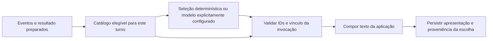

# Expressão verificável e adaptação à ferramenta original

## Resultado principal

Há um núcleo reutilizável independente do modelo: fatos tipados, resultados
mecânicos preparados, opções elegíveis por estado, validação local e apresentação
com proveniência. Isso pode reduzir a responsabilidade semântica exigida de um
modelo leve. O estudo não demonstrou que um modelo pequeno, gratuito ou local
consegue produzir narrativa livre fiel, nem que uma LLM melhora a escolha entre
as opções autoradas. O benefício sobre seleção determinística continua desconhecido.

A prova isolada fechou a linguagem de saída: o modelo hipotético só escolhe IDs;
todo texto exibido vem do catálogo da aplicação. Assim, a propriedade verificada
é ausência de texto arbitrário da resposta na apresentação. A verdade do catálogo,
sua elegibilidade e a equivalência das variantes continuam sujeitas a curadoria.
Uma contraprova com frase falsa inserida pelo autor confirma esse limite.

## Escopo autorizado e pergunta

Usuário: “Continue o estudo”, considerando uma possível adaptação à ferramenta
original, agnóstica de modelo e voltada a modelos gratuitos/leves/locais.
Essa hipótese orientou a investigação; não virou escolha de provedor, arquitetura
definitiva, migração ou autorização de publicação. Timebox: esta sessão; estudo
concluído antes de iniciar implementação no runtime ou novos lotes de inferência.

Pergunta: quais garantias podem ser obtidas da aplicação e reaproveitadas sem
exigir uma capacidade específica de geração de prosa? Escopo: inspecionar os dois
checkouts, comparar alternativas, executar prova offline e testes com transporte
simulado, preparar uma proposta concreta de adaptação. Nenhum serviço iniciado,
modelo baixado, segredo acessado, chamada paga/gratuita/local de inferência,
commit/push ou alteração no checkout original. Custo novo de inferência: USD 0.

## Estado observado no código

| Superfície | Evidência atual | Implicação |
|---|---|---|
| Original em master | README descreve LM Studio e divisão entre papéis; api/orchestrator_service.py: run_narrator_stream monta Chat Completions e entrega deltas HTTP diretamente | Troca de alvo prevista, mas domínio e transporte ainda próximos; copiar apenas um prompt não reproduz as garantias novas |
| Original, H0/H1/H4 | Chamadas httpx diretas em h0_controller_service.py, parser_service.py e h4_lore_expert_service.py | A futura adaptação deve cobrir essas fronteiras gradualmente; H6 sozinho não garante a cadeia toda |
| Worktree b008 | api/llm/contract.py: LLMTarget, LLMGateway, capabilities native/emulated/unsupported/unknown | Contrato reutilizável sem decidir fornecedor ou qualidade do modelo |
| Adaptador comum | api/llm/adapters/openai_compatible.py: generate_structured e validação Pydantic local | HTTP bem-sucedido ou JSON válido não basta; IDs e vínculo precisam de validação de domínio |
| A1 v2 | Plano/estado preparados, composição crítica, fonte com autoria segmentada, persistência versionada | Reutilizar princípios e contratos; renderer atual continua específico da microcampanha |
| L85 | 17 turnos técnicos, 14 sem texto opcional, silêncio não estabelecido aceito | Nenhuma prova de benefício narrativo da LLM ou de fidelidade geral |

A inspeção da ferramenta original foi somente leitura. Seu README contém claims
históricos de fidelidade/latência que não foram tratados como resultados medidos.
Agnosticismo de interface, confiabilidade narrativa, custo de serviço e capacidade
do hardware são quatro questões diferentes. A arquitetura pode ser agnóstica e
mesmo assim reprovar determinados alvos. Nenhum padrão foi alterado.

## Alternativas avaliadas

| Desenho | Propriedade verificável | Limitação |
|---|---|---|
| A1: núcleo autorado + texto livre | Núcleo/referências/estado preservados | Texto livre pode contradizer ou acrescentar conteúdo não estabelecido |
| A2: seleção entre expressões autoradas elegíveis | Resposta não introduz prosa nova; escolha fora do conjunto é rejeitada | Curadoria, cobertura, repetição e custo de autoria; modelo pode ser dispensável |
| Compositor determinístico usando o mesmo catálogo | Mesma fronteira factual sem chamada LLM | Menor adaptação estilística possível; precisa ser comparado editorialmente |
| Prosa livre seguida de outro modelo avaliador | Pode fornecer evidência adicional de qualidade | Segundo modelo também falha; custo/latência; não oferece prova geral de verdade |
| Schema/gramática com campos de texto livre | Restringe formato e campos | Mantém espaço semântico aberto dentro das strings |

Não substituir a proposta futura de resolvedor por dois modelos. A2 atua somente
na apresentação de uma consequência já decidida. Não reabre ALT-003 nem permite
que seleção estilística escolha resgate/perda, rolagem, segredo ou ação do jogador.

## Contrato experimental proposto



Exemplo de resposta proposta, não resposta real de modelo:

```json
{"utterance":"R-06.variant","atmosphere":"none","layout":"inline"}
```

- Aplicação fornece somente opções públicas elegíveis, com rótulos e textos suficientes
  para a escolha. Não envia segredos, catálogo inteiro ou permissão de alterar estado.
- Resposta tem três enums planos; sem texto livre, efeito, campo de estado, confiança
  autodeclarada ou justificativa. IDs e schema são locais ao catálogo preparado.
- Sessão, operação, turno, revisão, hash do plano e do catálogo ficam em vínculo
  retido na aplicação. O modelo não precisa copiar um hash longo. Esse vínculo deve
  vir da invocação confiável; não é campo livre retornado pelo cliente/modelo.
- A validação rejeita campos extras, escolha fora do conjunto, tipo errado, resposta
  malformada e vínculo divergente antes de compor/exibir. Sem reparo ou segunda
  tentativa automática. Falha deve usar o contrato de pausa/erro explícito vigente.
- Texto tem autoria da aplicação. Registrar separadamente que a seleção veio de
  modelo ou política determinística, junto da evidência da invocação. Não atribuir
  autoria da frase ao modelo nem chamar escolha de fato canônico.
- Persistir texto final, catálogo/versão, escolha, referências e proveniência;
  replay devolve o texto retido, sem reescolher, rerrolar ou chamar modelo.
  Integração transacional/replay é requisito futuro, não resultado deste protótipo.

Hashes comprovam igualdade e vínculos quando confrontados com fonte confiável;
não certificam veracidade, autorização ou equivalência de uma frase.

## Prova offline e contraprovas

Protocolo registrado antes da execução em
`evals/narrator/spikes/expression-selection-2026-10-21/protocol.md`.
Código independente da aplicação em `probe.py`; biblioteca padrão apenas, rede
bloqueada na execução, observação recusa sobrescrita. Entrada: registros L85
preservados, somente 17 estados já observados. Não simula competência de uma LLM.

Por plano: consequência física e pergunta retidas; duas formas autoradas da fala
essencial; atmosfera vazia ou posição conhecida do registro; dois layouts.
O catálogo tem 10 variantes novas de fala por regra (R-01..R-09 incluindo R-03B).
A variante R-01 contempla a pergunta de tarefa vista no L85; pedido de ajuda,
repetição e outros estados fora da matriz não estão cobertos. Não generalizar IDs
por regra sem considerar variante, negação, modalidade, ator, fase e condições.

| Observação | Resultado |
|---|---:|
| Planos de entrada | 17 |
| Combinações enumeradas | 136, oito por plano |
| Respostas malformadas/fora de opções rejeitadas | 238, 14 por plano |
| Trocas de vínculo/catálogo rejeitadas | 119, sete por plano |
| Aceitações inesperadas nesses casos | 0 |
| Frase falsa inserida no catálogo confiável | Aceita, contraprova deliberada |
| Inferências | 0 |

As 136 apresentações mantiveram consequência, pergunta e referências; offsets
foram conferidos. Todas as frases vêm da aplicação. A fala alternativa foi
revisada como proposta editorial, não provada semanticamente por enum/hash.
A atmosfera de posição repete informação em vários resultados; não há evidência
de que acrescentá-la melhore a experiência. A linha determinística escolhe
original/sem atmosfera/layout inline e usa a mesma fronteira de validação.

Contraprova deliberada: em resgate parcial, o autor confiável adiciona “As páginas
já secaram por completo” ao catálogo e a versão correspondente é reconhecida como
vigente. A escolha é estruturalmente aceita e o texto contraditório é composto.
Portanto, retirar texto livre do modelo transfere a obrigação semântica para a
curadoria/gerador do catálogo. Não elimina erros de conteúdo de todo o sistema.

As respostas de escolha têm 66–75 bytes UTF-8. O contexto de rascunho desta prova,
com estado/catálogo/schema, tem 2.850–3.063 bytes. Isso não inclui envelope HTTP,
chat template ou tokens de raciocínio. Não comparar diretamente com o request
HTTP de até 9.352 bytes do L85 como se fosse redução medida de tokens, custo,
latência, RAM ou VRAM. Nenhum desses ganhos foi medido com modelo real.

### Portabilidade observada no adaptador

`tests/test_expression_selection_spike.py`: oito testes passam, com MockTransport,
sem rede/chave, nos modos native e emulated. Escolha válida é aceita, campo de
prosa extra e ID desconhecido são rejeitados, sem retry. O modo native envia schema;
emulated depende do texto instruído e da validação local. Isso demonstra formato
compatível com o adaptador existente, não conformidade de um servidor/modelo real.

Limite encontrado e deixado intacto: o parser comum aceita chaves JSON duplicadas,
preservando a última (`json.loads`). A prova pura as rejeita. Os testes registram
essa diferença; oito testes verdes não significam que o runtime rejeita duplicatas.
Não mudou código global fora do escopo. Uma integração que prometa parsing estrito
precisará resolver isso no ponto correto, antes de perder os bytes da resposta.
O problema não autoriza inserir frase fora do catálogo, mas permite ambiguidade
de seleção/registro e impede transportar a garantia de parsing sem adaptação.

XML: `eval-results/expression-selection-adapter-study-2026-10-21.xml`.
Aviso preexistente python_multipart, sem alteração de dependências.

## Modelos leves, gratuitos e locais

A hipótese é plausível porque a tarefa de saída pode ser menor e a apresentação
não depende de o modelo redigir todos os fatos. Isso é inferência de desenho,
ainda sem benchmark. Um modelo pequeno pode escolher mal, errar JSON, ignorar
contexto ou exceder o tempo; a aplicação pode rejeitar a saída, mas não fabricar
qualidade ou disponibilidade. Se todas as opções são elegíveis, escolher a menos
natural ainda pode ser seguro factualmente e ruim como experiência.

Documentação oficial consultada em 21/10/2026:

- [LM Studio — Structured Output](https://lmstudio.ai/docs/developer/openai-compat/structured-output):
  documenta JSON Schema em `/v1/chat/completions`. É um caminho de transporte a
  verificar em alvo exato; não comprova qualidade narrativa nem funcionamento no PC.
- [Ollama — Structured Outputs](https://docs.ollama.com/capabilities/structured-outputs):
  documenta schema no campo format e validação local. A capacidade do servidor
  local não deve ser presumida para todas as modalidades de hospedagem.
- [llama.cpp — Grammars](https://github.com/ggml-org/llama.cpp/blob/master/grammars/README.md):
  documenta GBNF e subconjunto de JSON Schema, inclusive limitações. Recomenda-se
  schema simples e validação local completa. Restringir tokens de saída não
  entrega automaticamente ao modelo a semântica da tarefa.

Não foi escolhida uma família/tamanho de modelo ou oferta gratuita. “Gratuito”
qualifica condições comerciais/cota, “leve” exige orçamento de recursos e “local”
diz onde a inferência roda; nenhum desses rótulos prova capacidade. Uma avaliação
real exigirá alvo/versão/quantização/contexto/hardware e limites explícitos. Não
baixar pesos nem iniciar servidor como consequência automática deste estudo.

## Caminho de adaptação à ferramenta original

1. **Reaproveitar o contrato e a separação de autoridade.** Inventariar chamadas H0,
   H1, H4 e H6; preservar intenções e configurações existentes. Introduzir fronteiras
   testáveis por etapa, em recorte separado, antes de acoplar qualquer novo renderer.
2. **Preparar resultado tipado.** O system_log textual do original não basta como
   autoridade verificável. Mapear resultados já calculados para fatos/efeitos,
   posições, ator, visibilidade e revisão; manter RNG e regras existentes.
3. **Comparar baseline e seleção em uma cena coberta.** Usar catálogo autorado
   pequeno e opções elegíveis. Medir qualidade com opções de autoria fixas;
   separar ganho do catálogo de ganho da escolha feita pela LLM.
4. **Integrar apresentação persistida e falha explícita.** O original entrega
   deltas livres ao cliente; avaliar validação antes de exibir texto escolhido,
   pausa/cancelamento, commit e replay. Não aplicar por patch isolado de prompt.
5. **Testar alvos após o contrato passar offline.** Mesmo corpus, versão, resultado
   e orçamento por candidato; target fixo e sem fallback silencioso. Registrar
   configuração local/hardware quando houver. Não promover disponibilidade a admissão.

Não copiar literalmente a microcampanha de Mara para todo o jogo. Reutilizáveis:
interfaces, vínculos, estado preparado, elegibilidade, proveniência e testes.
Específicos: regras R-01..R-09, falas, posições e conteúdo editorial do registro.
H0/H1/interpretação de ações, cobertura de mundo aberto, lore/memória e outras
fontes de invenção permanecem trabalhos separados. A2 não os resolveu.

## Recomendação e próximos critérios

Manter a direção agnóstica como critério do estudo. Usar o compositor determinístico
como baseline explícita e a LLM como seleção opcional a justificar por ganho
editorial medido. Não exigir um modelo maior como solução presumida; também não
prometer que escolhas restritas preservam a criatividade desejada para RPG aberto.

Proposta de próximo recorte, ainda sem integração aprovada: ensaio isolado de
seleção de expressão em novas sessões sintéticas, com contrato versionado distinto
de A1, cobrindo também R-01 ajuda/repetição e R-08/R-09 variantes molhadas. Critérios:
nenhuma escolha altera efeito; nenhuma string arbitrária entra no texto; todas as
alternativas têm revisão editorial e condições explícitas; replay/concorrência/
falha preservam operação; native e emulated têm garantias documentadas; contribuição
do modelo é comparada com baseline. Se não houver diferença útil, usar a baseline
é resultado válido do experimento, sem inventar necessidade de inferência.

Não houve implementação de A2 no produto. A aprovação de continuar o estudo não
aprovou migração do original ou fechamento da autoria do jogo. Essas decisões
precisam considerar a perda de improvisação e o custo de curadoria, com o protótipo
e suas apresentações como evidência concreta.

## Reprodução e integridade

Na raiz do worktree, com saída nova (não sobrescrever a observação original):

```powershell
$env:STORYTELLER_DISABLE_DOTENV = '1'
$env:PYTHONDONTWRITEBYTECODE = '1'
& .\.venv\Scripts\python.exe evals/narrator/spikes/expression-selection-2026-10-21/probe.py --records eval-results/hybrid-campaign-luna-l85-a60bde9c-5fff-46d6-95a0-f50c120a1761/records.jsonl --output eval-results/expression-selection-new-observation.json
& .\.venv\Scripts\python.exe -m pytest tests/test_expression_selection_spike.py -q
```

Observação congelada: `evals/narrator/spikes/expression-selection-2026-10-21/observation.json`.
Inclui hashes do script, protocolo e registros de entrada, catálogo por plano,
136 apresentações, baseline e contraprova do autor. Nenhum resultado L84/L85 foi
reescrito. O estado do estudo não deve ser apresentado como resultado de modelo.

## Histórico

| Data | Estado | Evidência |
|---|---|---|
| 21/10/2026 | Estudo autorizado | Usuário pediu continuidade e hipótese de adaptação agnóstica |
| 21/10/2026 | Estudo offline concluído | 136 combinações, 357 rejeições delimitadas, oito testes de adaptador e limite editorial demonstrado |
| Pendente | Integração/aceite | Nenhum default, provedor, save ou arquitetura de produto alterado |
